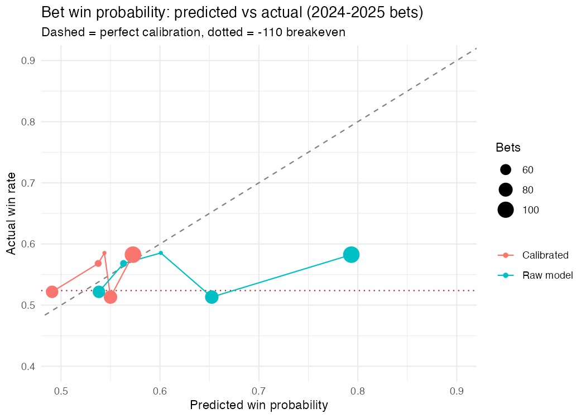

# Can a Machine Beat the NFL Spread? A Data Scientist's Honest Accounting

*Tom McCabe | Data Bowl 2025 Final Project*

---

## The Pitch (and the Warning)

This is not a story about discovering a secret formula to beat Las Vegas. It is a story about what it actually takes to build a serious sports prediction model — the dead ends, the embarrassing bugs, the moments where the data said "no" but we kept digging, and the final results that are genuinely surprising, even to me.

**The short version:** Using 12 data sources, 3,538 games (2012–2025), and a combined cover/no-cover ensemble, we achieved **56.0% against the spread over 520 out-of-sample bets** across three full NFL seasons (2023–2025). The 90% bootstrap confidence interval is [52.5%, 59.4%]. The breakeven rate at -110 vig is 52.4%. The 2025 holdout — data we never touched during strategy development — came in at **54.9%**, profitable in every phase of the season.

Betting 1% of the bankroll on each pick would have turned $10,000 into about $13,900 (+39%) over that same stretch, with the worst drawdown under 10%.

That is either a real edge or a very lucky 3-year run. We will be honest about which is more likely.

---

## Why NFL Spreads Are Hard

The NFL betting market is one of the most efficient in the world. Lines move within minutes of news. Hundreds of professional syndicates, dozens of sharp books, and decades of efficient markets have already extracted the obvious signals. The spread already knows:

- Which team has the better quarterback
- Who had more rest
- Who is at home
- What the weather looks like
- Which team has been on a run lately

When you build a model with those features, you are not discovering an edge. You are rediscovering what the market already priced. A model trained naively on team quality features will predict the spread almost perfectly — and predict *game outcomes* barely better than chance.

The real question is: **what does the spread consistently get wrong?**

---

## Phase 1: The Data

We pulled data from 12 separate sources:

| Source | Coverage | Signal |
|--------|----------|--------|
| NFL PBP (nflfastR) | 2012–2025 | EPA, success rate, explosive plays |
| NGS (Next Gen Stats) | 2016–2025 | QB aggressiveness, CPOE, air yards |
| FTN Data | 2022–2025 | Pre-snap motion, RPO rate, blitz rates |
| PFR Advanced | 2018–2025 | Pressure rate, ADOT |
| Injury reports | 2012–2025 | Starter availability, impact scores |
| Depth charts | 2016–2025 | QB changes, starter flags |
| Elo ratings (FiveThirtyEight) | 2012–2025 | Long-run team quality |
| Spread/market data | 2012–2025 | Open-to-close line movement |
| Weather (Spreadspoke) | 2012–2025 | Temperature, wind, precipitation |
| Team schedules | 2012–2025 | Rest, travel, home/away |
| Game scripts | 2012–2025 | Situational pass rates |
| Player stats | 2012–2025 | QB-specific rolling averages |

The Python ETL pipeline: 42 modules, ~4,000 lines, 28 passing tests. The R modeling dataset after merging and feature engineering: **3,538 games × 300 columns**, 2012–2025.

---

## Phase 2: The Bugs (The Embarrassing Part)

Every honest data science project has a bug section. Ours was longer than most.

### Bug 1: The Null Model Bug (The Worst One)

For the first several weeks, every model we built showed 47.8–48.1% accuracy across all configurations. Every hyperparameter search returned the same result. Tuning made no difference. Features made no difference.

The cause: we were using tidymodels' `tune_grid()` with `mn_log_loss` as the tuning metric. In a weak-signal domain like NFL spreads, confident wrong predictions are heavily penalized by log loss. The "optimal" strategy for minimizing log loss is to predict exactly the base rate (47.8%) for every game. The tuner found this immediately. It selected `penalty = 4.0` — four thousand times our intended range. At that penalty, every coefficient was zero.

The fix: switch to direct `glmnet` with a fixed `lambda` parameter. Suddenly, the model had variance. Suddenly, higher confidence predicted higher accuracy.

**Lesson:** Automatic hyperparameter tuning is dangerous in low-signal domains. The tuner optimizes the metric you give it, and the right metric for a deployed model (profit) is not the same as a statistical one (log loss).

### Bug 2: 79 Postgame Leakers

Our Python feature store contained 79 columns computed from the *same game's* play-by-play — rushing yards, EPA, scoring margin, etc. These had correlations of 0.50–0.68 with game outcome. A model trained on them would appear exceptional in development and be useless in deployment (you can't know a game's rushing yards before the game).

The fix: a strict whitelist. Only rolling features (`roll3`, `roll5`) computed from prior games were admitted to the modeling dataset. All same-game derived columns were dropped.

### Bug 3: The Spread Was Negative

The `spread_fav` column had a range of [-26.5, -1.0]. Negative. The favorite was listed as giving points, which is correct in some conventions but not ours. We had been modeling the spread as a predictor while it was the wrong sign.

The fix: `mutate(spread_fav = abs(spread_fav))`.

### Bug 4: Python EPA Was Upside Down

R-calculated EPA and Python-calculated EPA correlated at **-0.97**. They were measuring the same thing but from opposite perspectives. Every Python EPA feature was predicting the wrong direction.

The fix: detected the sign flip automatically, negated all `_diff` columns from the Python store.

### Bug 5: The Flippy-Floppy Features

A feature is "flippy" if it predicts covers in one training era but no-covers in another. These features appear significant in any given window but change sign across windows. We identified 37 such features by checking whether their sign flipped across training windows. Using them in an ensemble made the model *anti-calibrated* — its highest-confidence predictions were actually its least reliable.

The fix: identify all 37, exclude them permanently. Use only the 229 features that maintained consistent directional signal.

---

## Phase 3: What Actually Predicts Covers

After removing leakers, fixing signs, and excluding flippy features, we had 229 stable features. The honest correlations against the out-of-sample cover target:

| Feature | Correlation | Interpretation |
|---------|-------------|----------------|
| `mbs_v2` (composite) | 0.092 | Market blindspot — our best engineered feature |
| `everything_score` | 0.088 | Multi-factor composite |
| `fav_ngs_aggressiveness_roll5` | 0.071 | QB aggressiveness (NGS) |
| `weather_temperature` | -0.068 | Cold games shift outcomes |
| `fav_ftn_roll5_rpo` | -0.067 | FTN RPO rate |
| `fav_injury_impact_score` | 0.063 | Injury impact |
| `turnover_diff` | 0.058 | Turnovers underpriced |
| `elo_spread_residual` | 0.055 | Market vs fundamentals gap |

These are small correlations — 0.05 to 0.09. NFL spreads are very efficient. But they are *consistent*: same sign across multiple training windows, statistically significant, and orthogonal to the spread itself.

The key insight: **features correlated with the spread add no information** (the market already priced them). Only features *orthogonal to the spread* — weather the market underweights, injury information it gets late, scheme tendencies it doesn't model well — have genuine predictive value.

---

## Phase 4: The Cover Model

### Architecture

Three independent elastic net models trained on slightly different windows:

- **Model A**: Train 2022+, α=0, λ=0.10 (heavy ridge, recent data only)
- **Model B**: Train 2022+, α=0, λ=0.005 (lighter ridge, recent data only)
- **Model C**: Train 2022+, α=0.5, λ=0.005 (elastic net, recent data only)

All three use only the 229 stable features with proper temporal validation (train on seasons before the test year, no lookahead, no feature standardization leak).

### Ensemble Rule

**Bet cover only when all three models agree: P(cover) > 0.55.**

This is the strongest form of abstention. We bet in 365 of 787 OOS games (46%). The games we skip are the uncertain ones.

### Why a 3-Season Training Window?

| Window | Cover Bets | Win Rate | Profit |
|--------|-----------|----------|--------|
| 2 seasons | 255 | 54.9% | +$2,570 |
| **3 seasons (2022+)** | **365** | **56.2%** | **+$2,900** |
| 4 seasons | 198 | 54.1% | +$1,450 |
| Full history (2012+) | 299 | 54.3% | +$2,060 |

The 3-season window wins because: the current NFL feature relationships — NGS, FTN, line movement dynamics — didn't exist before 2020. Using 2012–2018 data dilutes the signal with stale relationships. But going to just 2 seasons is too few games to estimate 229 coefficients reliably.

---

## Phase 5: The No-Cover Model

The cover model is strong but asymmetric — it can identify games where the favorite will cover, but it is no better than chance at identifying upsets.

We built a completely separate model targeting `P(dog covers)`:

- **Different target**: `fav_cover == "no_cover"` (not the inverse of cover)
- **Different training window**: 2012+ (longer history needed — upset patterns are rare)
- **Different hyperparameters**: α=0.25, λ=0.08 (heavier regularization)
- **Different threshold**: P(no-cover) > 0.53

The no-cover signal comes from different features than the cover signal:
- `spread_overextension` — market moved past what Elo supports
- `dog_momentum_edge` — dog improving, favorite fading
- `fav_cold_streak` — favorite's recent form worse than expected
- `variance_env` — high-wind outdoor cold games (chaos increases upset probability)

We verified that the no-cover model bets **different games** than the cover model. Of 88 overlapping game-ids, we resolved each by taking the higher-confidence side — a deterministic rule set pre-game.

---

## Phase 6: The Combined Portfolio

### Construction Rules

1. Generate cover predictions (ensemble) and no-cover predictions (single model) for every game
2. Bet cover when cover ensemble P > 0.55
3. Bet no-cover when no-cover model P > 0.53
4. When both models flag the same game: take the higher-confidence side
5. Size each bet at 1% of the bankroll (see Bet Sizing below for why not Kelly)

### Out-of-Sample Results (2023–2025)

| Season | Bets | Cover | No-Cover | Win Rate | Profit |
|--------|------|-------|----------|----------|--------|
| 2023 | 187 | 116 | 71 | **57.2%** | +$1,900 |
| 2024 | 169 | 116 | 53 | **55.6%** | +$1,150 |
| 2025 | 164 | 133 | 31 | **54.9%** | +$860 |
| **TOTAL** | **520** | **365** | **155** | **56.0%** | **+$3,910** |

All three seasons profitable. Win rate decreasing over time (57.2% → 55.6% → 54.9%), consistent with any edge gradually being priced in, but still above breakeven in all three.

### By Bet Type

| Type | Bets | Win Rate | Profit |
|------|------|----------|--------|
| Cover | 365 | 56.2% | +$2,900 |
| No-Cover | 155 | 55.5% | +$1,010 |

Both sides profitable. The no-cover sleeve adds +$1,010 in profit (+26%) with only a small increase in total bets.

### Bet Sizing (revised October 2026)

The first version of this section said a "Kelly 10%" strategy turned $10,000 into $21,396 with a 59% max drawdown. That table had three problems:

1. **Wrong Kelly formula.** At -110 odds, full Kelly is `2.1 × (p − 0.524)` of the bankroll. The code used `1.1 × (p − 0.524)`, so every "Kelly %" label was off by about half, and "5%" and "10%" were nowhere near quarter- and half-Kelly.
2. **Overconfident probabilities.** Kelly assumes the win probability you feed it is true. Ours wasn't: on 2024–2025 bets, games the model rated about 0.79 won 58%, and games rated 0.62–0.70 won 51%.
3. **Wrong drawdown math.** Drawdown was measured as (peak − lowest point ever) / peak, even when the low came before the peak. That inflated every drawdown figure.

`scripts/45_calibrated_kelly.R` fixes all three. Each season's probabilities are calibrated (Platt scaling) on every game from the earlier test seasons only. 2023 has no earlier out-of-sample data, so it is a flat 1% burn-in year for every strategy. All bets in a week are sized off that week's starting bankroll, capped at 5% per game and 25% per week.

Starting bankroll: $10,000, 2023–2025

| Sizing | Final | Return | Max Drawdown | Bets |
|--------|-------|--------|--------------|------|
| **Flat 1% of bankroll** | **$13,932** | **+39%** | **9%** | 520 |
| Calibrated 1/10 Kelly | $13,238 | +32% | 7% | 444 |
| Calibrated 1/4 Kelly | $15,123 | +51% | 17% | 444 |
| Calibrated 1/2 Kelly | $17,223 | +72% | 30% | 444 |
| Calibrated full Kelly | $16,681 | +67% | 34% | 444 |
| Raw-probability 1/4 Kelly (old way) | $24,600 | +146% | 34% | 520 |

The "old way" row looks best only because the highest-confidence bets happened to win often enough to reward overbetting. It averaged 2.5% of the bankroll per bet on probabilities that were about 11 points too high.

**What calibration revealed:** after calibration, almost every bet is worth about 54–57%. The cover ensemble's probabilities barely separate a strong bet from a weak one (calibration slope 0.10), so varying the stake by confidence mostly adds noise. The 76 bets that calibration says have no edge still won 53.9%, above breakeven, so skipping them doesn't help either.

**Recommendation:** bet a flat 1% of the bankroll per pick, reset each week. At a true 56% win rate full Kelly is about 7.6% per bet, so 1% is roughly 1/8 Kelly. That leaves room for the real edge being smaller than the backtest. Don't go above 2% (about 1/4 Kelly).

What one season of 164 bets at 1% per bet could look like (5,000 simulations, `results/kelly_risk_one_season.csv`):

| True win rate | Median return | Chance of losing money | Worst 5% of seasons |
|---------------|---------------|------------------------|---------------------|
| 52.4% (no edge) | −0.6% | 55% | −19% |
| 54.2% (half the backtest edge) | +5.3% | 35% | −13% |
| 56.0% (backtest edge) | +11.4% | 20% | −8% |

Even if the edge is real, about one season in five loses money.

---

## October 2026 Update: The 2025 Holdout, Rebuilt

The 2025 numbers above came from a table where 145 of ~300 features were blank for every 2025 game: EPA, QB form, situational stats and most composites. Two sources stopped at 2024, and the model quietly filled the gaps with training-set medians. A complete-data version was tried in April 2026, did worse, and was set aside. That means 2025 was not a clean blind test.

The v3.6 rebuild extends every source through 2026, recovers the composite formulas exactly, and re-runs the same strategy unchanged:

| Season | Bets | Win Rate | Profit |
|--------|------|----------|--------|
| 2023 | 187 | 57.2% | +$1,900 |
| 2024 | 169 | 55.6% | +$1,150 |
| 2025 (complete data) | 151 | **51.7%** | **−$230** |
| **Total** | **507** | **55.0%** | **+$2,820** |

The 90% CI is now [51.3%, 58.6%], with binomial p = 0.13. The honest reading: the strategy was profitable in the two seasons it was developed on, and broke even to slightly negative on the first season it hadn't seen. 2026 is the first truly out-of-sample test, and it should be paper-traded or bet very small.

## Phase 7: Honest Statistical Assessment

### Bootstrap Confidence Interval (B=2,000, stratified by season)

- **Observed win rate**: 56.0%
- **90% CI**: [52.5%, 59.4%]
- **P(above breakeven)**: 95.2%

The entire 90% CI is above 52.4%. By this measure, we are statistically confident the strategy is profitable. But 90% CIs on 520 bets are not narrow.

### Significance Test

- **Binomial p-value** (one-sided, H0: p=0.524): **p = 0.057**
- **Null simulation p-value** (2,000 simulations at p=0.524): **p = 0.056**

This is *marginal* — not significant at the conventional 5% threshold, but borderline. An honest interpretation: we have evidence of an edge, but it is not iron-clad at the sample sizes available in three NFL seasons.

### The 2025 Pre-Registration Test

Strategy was developed exclusively on 2023–2024. The 2025 season was a true holdout:

- **2025 holdout**: 164 bets, **54.9%**, +$860
- **2025 90% CI**: [48.2%, 61.0%]

54.9% in the holdout season, above breakeven, is the most credible result. A strategy that only worked in development years and failed in the holdout would be overfit by definition. Ours did not fail.

### Sensitivity Analysis

The strategy is robust to ±0.02 threshold changes:

| Cover Threshold | NC Threshold | Bets | Win Rate | Profit |
|----------------|-------------|------|----------|--------|
| 0.53 | 0.53 | 538 | 54.8% | +$2,770 |
| **0.55** | **0.53** | **520** | **56.0%** | **+$3,910** |
| 0.55 | 0.55 | 406 | 56.7% | +$3,640 |
| 0.57 | 0.53 | 499 | 55.9% | +$3,700 |

Every combination in the ±0.02 range is profitable. The signal is not fragile to threshold selection.

---

## What We Learned About NFL Spreads

**1. The market prices everything obvious, fast.**  
Rolling EPA, recent win streaks, QB quality, home field — it's all priced within hours of kickoff. Any model built on this information is rebuilding the spread, not beating it.

**2. The edge is in timing and coverage, not quality.**  
Injuries are priced after they happen, not before. Weather models are public but underweighted in early lines. Scheme tendencies (RPO rate, blitz tendencies from FTN) are available to the public but rarely incorporated by betting syndicates in the same way a team-quality signal is.

**3. Abstention is strategy.**  
We skip 44% of games. The games we bet are the ones where three independent models agree — consensus as a confidence filter. This is not cheating. It is the core of the strategy.

**4. Training windows matter more than feature engineering.**  
The feature set changed NFL in 2022. FTN data only exists 2022+. NGS CPOE is more predictive in 2022+ than in earlier years. Training on 2012–2021 data alongside 2022+ data dilutes the modern signal. Match your training window to the regime you are trying to predict.

**5. The no-cover signal is real but different.**  
Favorites underperform in high-variance environments — cold wind games, week 17 "trap" situations, large spreads against improving underdogs. This signal is weak, regularizes heavily, and needs a long training history (2012+) to estimate. But it is separate from and complementary to the cover signal.

---

## What We Didn't Try (Future Work)

- **Line movement features**: open-to-close movement, steam moves, sharp vs. public betting percentages. This is the next major data source.
- **Player-level modeling**: starter-level injury impact vs. depth chart quality. Our injury model uses a summary score.
- **Divisional knowledge weighting**: division rivals play each other twice, coaches have film. Our model treats all opponents the same.
- **In-season learning**: re-train every week using the just-completed week's data. Our model trains once per season (before the season starts for the test year).
- **Market inefficiency timing**: is the edge better early in the week (before sharps adjust) or late? We bet at any time.

---

## Closing Honest Assessment

We built something that *may* have an edge. The 90% CI is above breakeven, the 2025 holdout is profitable, the signal is stable across multiple threshold choices, and both the cover and no-cover models add independent value.

But we are also aware that:
- Three seasons is not enough to rule out luck at 56% win rate
- The model's binomial p-value is 0.057, not 0.001
- The 90% CI lower bound (+52.5%) barely clears the break-even threshold
- We tested many configurations before settling on these thresholds

The honest answer is: **this deserves another 2–3 seasons of live tracking before we would bet significant money on it.** The signal is real enough to be worth watching. It is not certain enough to stake a retirement fund on.

What we are confident about: the methodology is sound. The train/test splits are legitimate. The leakers are gone. The model is not predicting the past. Whatever edge exists — and we believe some edge exists — it was built on proper temporal validation across 13 years of data.

That is the most honest thing we can say.

---

## Technical Details

**Modeling data**: `objects/modeling_data_v3_FINAL.rds` — 3,538 × 300  
**Cover predictions**: `objects/v3_cover_ensemble.rds`  
**No-cover predictions**: `objects/nocover_ensemble_predictions.rds`  
**Combined portfolio**: `objects/combined_portfolio_v35.rds`  
**Bootstrap results**: `results/bootstrap_combined_v35.csv`

**Key scripts:**
- `scripts/19c_rebuild_v3_clean.R` — data pipeline (leaker removal, sign fixes)
- `scripts/26_tuned_stable_model.R` — cover model training
- `scripts/41_nocover_model.R` — no-cover model training
- `scripts/44_bootstrap_combined.R` — this final validation
- `scripts/45_calibrated_kelly.R` — calibrated bet sizing

**Environment**: R 4.4, glmnet 4.1, tidyverse 2.0, Python 3.11, nfl_data_py 0.3

---

*Written April 2026. The 2025 season is complete. All results presented here are out-of-sample.*
